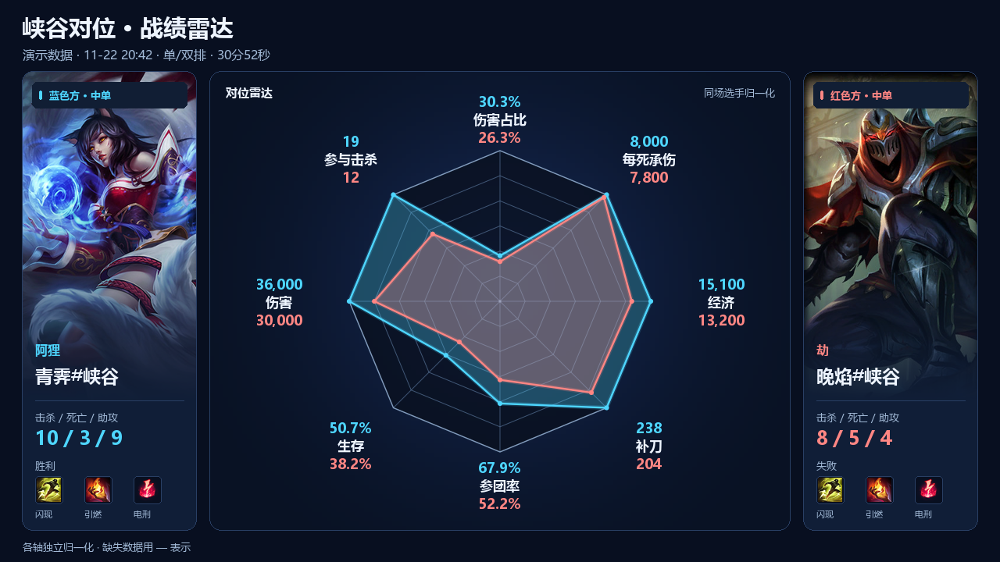

# 峡谷对位 · 战绩雷达

峡谷对位 · 战绩雷达是一款面向《英雄联盟》玩家的 Windows 桌面战绩分析工具。登录客户端后，软件会同步可读取的对局，用八维雷达图对比红蓝双方的表现，并优先配对同位置选手。个人主页汇总常用英雄、胜率、KDA 等数据，也可以通过 Riot ID 添加同大区的其他玩家。每个账号的战绩独立保存在本机，重复同步自动去重，支持离线查看和单独删除。软件还支持导出 PNG 和 WebM，方便复盘和分享。



## 下载

到 [Releases](../../releases/latest) 页面下载 `峡谷对位-战绩雷达-多账号版.exe`，双击即用，无需安装，也不需要 Python 环境。

> 单文件约 180 MB（内置英雄立绘、技能与符文图标、173 条英雄语音、17 首背景音乐，可完全离线使用）。

## 功能

- **八维雷达对比**：单场对局中蓝红双方各选一名选手，八项指标画在同一张雷达图上，上方为蓝方、下方为红方数值。
- **同位置优先配对**：召唤师峡谷按队伍统一识别上单、打野、中单、射手、辅助，切换任一方选手时，另一方优先跟到同位置。
- **自动同步与归档**：登录客户端后自动分页归档可读取的近期对局，保持登录时约每三分钟检查一次，也可点「同步战绩」立即检查。
- **个人主页**：汇总常用英雄、胜率、KDA 等数据，可与归档中可识别的同位置对手横向对比。
- **多账号**：通过 Riot ID（`玩家名#标签`）添加同大区其他玩家，每个账号的战绩独立保存在本机。
- **本地去重**：归档按账号和对局编号去重，重复同步不会产生重复记录；离线也能查看与删除。
- **导出分享**：支持导出 1280×720 的 PNG 和 60 FPS 的 WebM。
- **离线素材**：出场立绘、技能与符文图标、英雄语音、背景音乐全部内置在 EXE 中。
- **背景音乐**：内置歌单与唱片机控制，也可导入自己的 MP3 / WAV / FLAC / OGG。

## 使用要点

1. 打开英雄联盟并登录到游戏大厅，软件左上角会显示「已登录」。
2. 点「同步战绩」拉取近期对局，或点右下角「查玩家」输入完整 Riot ID 查看他人战绩。
3. 在「单场对比」中选择蓝红双方选手，雷达图与英雄海报会自动更新。
4. 战绩归档保存在 `%LOCALAPPDATA%\LoL-Radar\history.sqlite3`，卸载软件不会自动删除。

完整操作说明见 [使用说明.md](使用说明.md)。

## 从源码运行（Web 版）

仓库里的源码是桌面版使用的同一套前端与本地服务：一个只依赖 Python 标准库的 HTTP 服务，加上静态页面，没有构建步骤，也不需要第三方库。

```powershell
git clone https://github.com/skadi985/LoL-Radar.git
cd LoL-Radar
.\Start.cmd            # 或 python radar_server.py
```

启动后浏览器会自动打开本机页面，默认载入 `/api/demo` 的三场演示对局，不连客户端也能看界面。需要 Python 3.10 或更新版本，服务只监听 `127.0.0.1`。

| 参数 / 环境变量 | 说明 |
| --- | --- |
| `--port` | 指定端口，默认由系统分配 |
| `--no-browser` | 启动后不自动打开浏览器 |
| `--lockfile` | 指定 LeagueClient 的 `lockfile` 完整路径 |
| `LOL_RADAR_ASSETS` | 英雄素材库目录，其下需有 `champion_assets/` |
| `LOL_RADAR_LOCKFILE` | 等同于 `--lockfile` |

素材库（英雄图标、载入图、原画与 `heroes.min.json`）体积大且受版权约束，不在仓库内。缺失时界面降级为显示英雄名称，对局数据、雷达图与导出都不受影响；把从 Riot Data Dragon 或客户端缓存整理的素材放进 `assets/champion_assets/` 即可显示海报。

## 目录结构

```
radar_server.py      本地服务：LCU 连接、战绩归一化、静态资源与导出接口
public/index.html    页面骨架
public/app.js        对局选择、个人主页、导入与导出流程
public/radar.js      八维雷达绘制与动画
public/style.css     样式
public/loadout/      符文与召唤师技能图标（含 catalog.json）
demo.json            演示对局数据
Start.cmd            Windows 启动脚本
```

## 说明

- 软件只读取本机英雄联盟客户端（LCU）能返回的近期对局，最多 20 场；不向任何第三方服务器上传战绩。
- 仓库里的源码是 Web 版；[Releases](../../releases/latest) 里的 EXE 是同一套前端的桌面封装，额外内置了英雄素材、英雄语音与背景音乐，只想用软件的话下载 EXE 即可。
- 客户端接口受版本、登录状态或权限影响时，仍可通过「导入 JSON」读取包含选手数据的 LCU / Riot Match-V5 战绩。
- 本项目与 Riot Games、腾讯无关，英雄联盟相关素材版权归原权利人所有，本工具仅供个人复盘学习使用。
